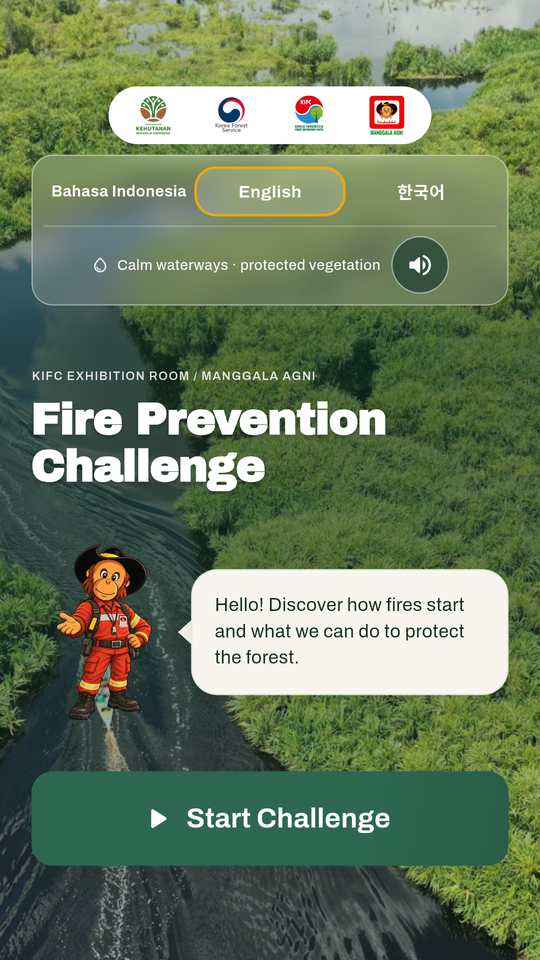
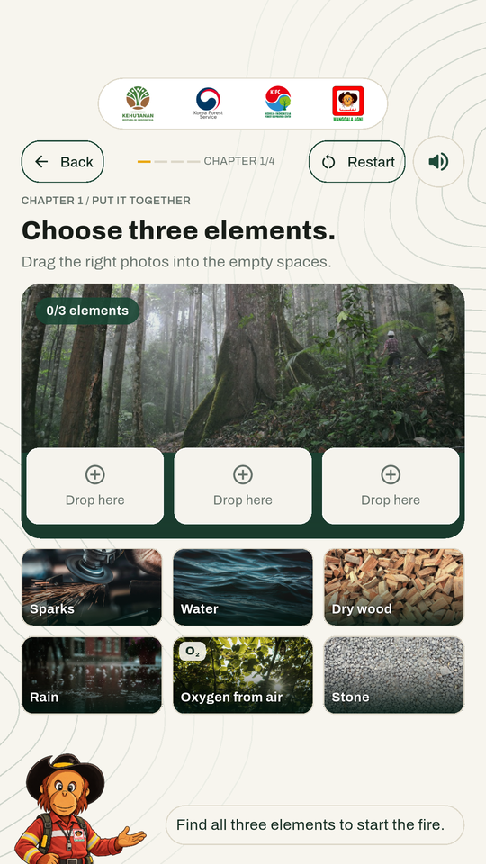
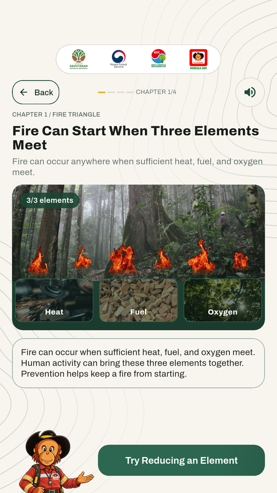
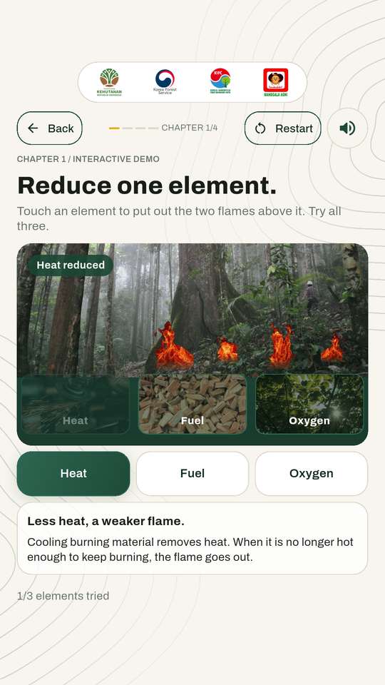
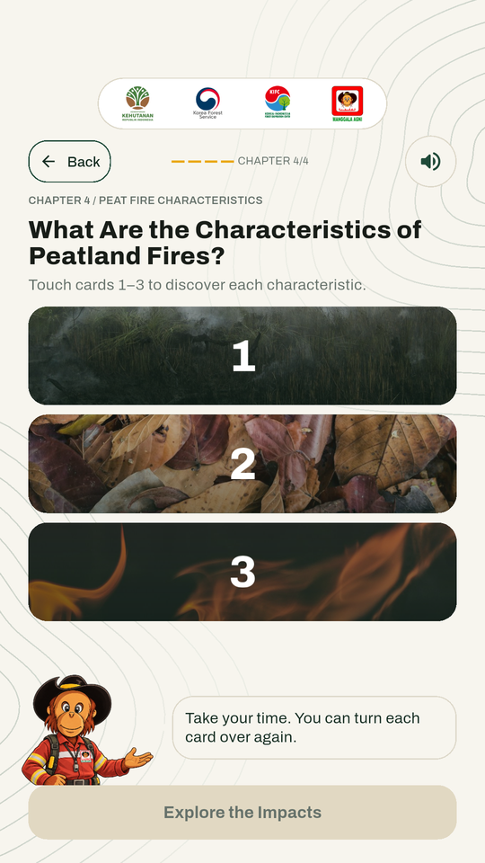
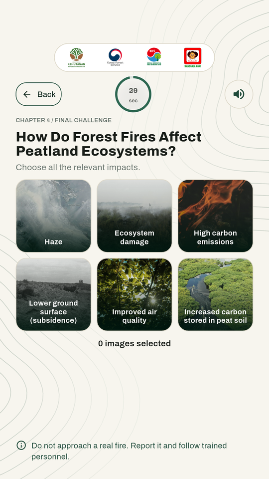
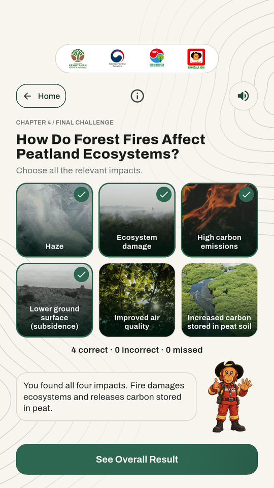
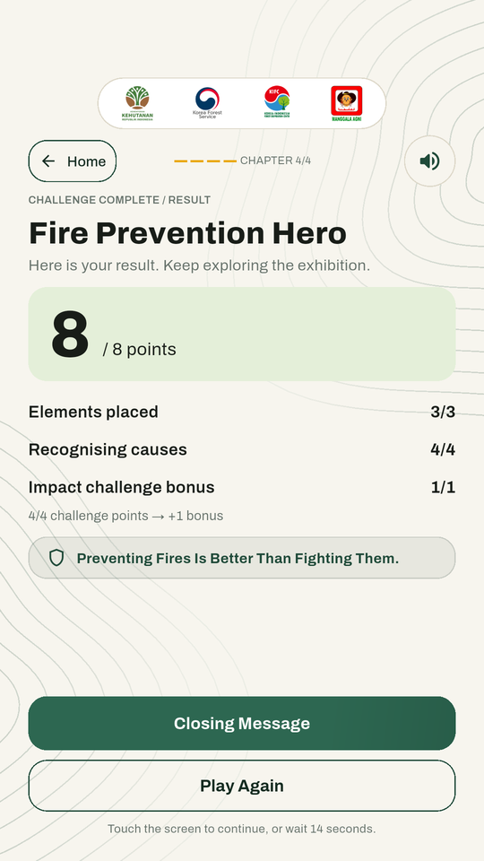

<div align="center">


# Fire Prevention Challenge

**Kenali penyebab api. Pahami risiko karhutla. Jaga ekosistem gambut.**

Game edukasi interaktif untuk ruang pamer **Korea–Indonesia Forest Center (KIFC), Zona 1**.
Dibuat untuk layar sentuh Android portrait, dengan versi web untuk peninjauan.

[](https://github.com/NazwanSM/KIFC_Exhibition_Game/actions/workflows/deploy-pages.yml)   

[**Mainkan di web**](https://nazwansm.github.io/KIFC_Exhibition_Game/) · [Cara menjalankan](#menjalankan-proyek) · [Hasil pengujian](#pengujian-dan-status) · [Tracker revisi](design/quick-specs/kifc-screen-revision-tracker-2026-10-23.md)

</div>

## Tentang proyek

Pengunjung belajar tentang kebakaran hutan dan lahan (karhutla) melalui empat babak: menyusun unsur api, memahami karhutla, mengenali penyebab kebakaran, lalu menjelajahi ciri dan dampak kebakaran gambut. Maskot Manggala Agni mendampingi dengan petunjuk dan penjelasan singkat.

Satu kode Flutter digunakan untuk APK Android dan web. Foto, maskot, font, animasi, serta audio disertakan di dalam APK agar permainan dapat berjalan **tanpa koneksi internet**. Versi web perlu memuat aplikasi dan aset dari server; jaminan penggunaan offline ditujukan untuk APK.

## Tampilan permainan

<table>
  <tr>
    <th>Pembuka &amp; tiga bahasa</th>
    <th>Menyusun unsur api</th>
    <th>Memahami segitiga api</th>
  </tr>
  <tr>
    <td><a href="docs/screenshots/welcome.png"></a></td>
    <td><a href="docs/screenshots/assembly.png"></a></td>
    <td><a href="docs/screenshots/fire-triangle.png"></a></td>
  </tr>
  <tr>
    <th>Mengurangi unsur</th>
    <th>Kartu informasi gambut</th>
    <th>Tantangan akhir</th>
  </tr>
  <tr>
    <td><a href="docs/screenshots/element-reduction.png"></a></td>
    <td><a href="docs/screenshots/peat-cards.png"></a></td>
    <td><a href="docs/screenshots/final-challenge.png"></a></td>
  </tr>
</table>

<details>
<summary><strong>Lihat ulasan jawaban dan ringkasan skor</strong></summary>
<br>
<table>
  <tr><th>Ulasan setelah waktu habis</th><th>Ringkasan skor</th></tr>
  <tr>
    <td><a href="docs/screenshots/impact-review.png"></a></td>
    <td><a href="docs/screenshots/score.png"></a></td>
  </tr>
</table>
</details>

Screenshot berasal dari **APK di emulator Android API 35, 1080 × 1920, density 420**, diambil pada 25 Oktober 2026 dalam bahasa Inggris. Gambar diperkecil secara proporsional menjadi 540 × 960 tanpa mengubah tampilan UI. Pembuka sampai kartu gambut memakai APK review **1.0.2**; tantangan, ulasan, dan skor memakai **1.0.1** dari pengujian E2E sebelumnya. [Indeks sumber dan checksum](docs/screenshots/index.json). Ini bukan foto atau bukti uji jangkauan TV fisik.

## Cara bermain

1. **Pilih bahasa dan mulai.** Tersedia Bahasa Indonesia, English, dan 한국어.
2. **Babak 1 — Tiga unsur api.** Seret foto yang sesuai ke tiga slot. Api muncul setelah panas, bahan bakar, dan oksigen lengkap. Baca penjelasannya, lalu coba kurangi setiap unsur: dua titik api tambahan padam pada setiap pilihan baru, dari 6 → 4 → 2 → 0.
3. **Babak 2 — Mengenal karhutla.** Baca tiga kartu penjelasan bersama maskot, kemudian jawab pertanyaan tentang hutan rawa gambut. Jawaban salah pertama mendapat petunjuk dan satu kesempatan lagi.
4. **Babak 3 — Mengenali penyebab.** Tentukan apakah empat situasi dipicu aktivitas manusia atau faktor alam, lalu baca alasannya.
5. **Babak 4 — Gambut dan dampaknya.** Buka tiga kartu informasi, kemudian pilih semua dampak yang sesuai dalam **30 detik**. Pilihan tetap netral selama tantangan; ulasan muncul setelah waktu habis.
6. **Lihat hasil dan bermain lagi.** Skor maksimum **8 poin**: unsur api 3, penyebab 4, dan bonus tantangan dampak hingga 1. Demo pengurangan unsur dan kartu informasi tidak menambah skor.

Feedback yang sudah selesai dan halaman hasil memberi waktu baca **15 detik**, atau dapat dilanjutkan lebih cepat dengan menyentuh konten/latar layar. Kartu bacaan dan kartu informasi dilanjutkan secara manual. Tombol navigasi, kartu, serta pengaturan suara tetap menjalankan fungsinya sendiri.

## Fitur utama

- **Dirancang untuk sentuhan portrait.** Target pameran adalah TV sentuh 42 inci; komposisi web dipertahankan dalam bingkai 9:16 saat ukuran browser berubah.
- **Maskot sebagai pemandu.** Petunjuk, kesempatan mencoba lagi, dan feedback memakai dialog serta pose yang mengikuti konteks.
- **Visual hutan dan api.** Foto dengan proporsi terjaga, enam titik api terpisah, animasi transparan dari rekaman, dan pemadaman bertahap.
- **Interaksi dan transisi.** Drag-and-drop, kartu flip, respons tombol, kemunculan feedback, serta countdown melingkar yang berubah warna mendekati akhir waktu.
- **Audio yang dapat diatur.** Musik, suasana hutan, dan efek interaksi memiliki kontrol terpisah serta mute. Audio dimulai setelah interaksi dan dijeda saat aplikasi tidak aktif. Tidak ada sulih suara maskot.
- **Aset lokal dan tiga bahasa.** Font Hangul ikut dibundel; APK tidak memerlukan akun, server aplikasi, atau unduhan aset saat bermain.

## Tech stack

| Bagian | Teknologi yang dipakai |
| --- | --- |
| Aplikasi & UI | **Flutter 3.35.5**, Material widgets, layout dan animasi Flutter |
| Bahasa pemrograman | **Dart 3.9.2**; batas SDK di `pubspec.yaml`: `^3.9.2` |
| State & alur | `StatefulWidget`, notifier, timer, dan navigasi tahap di dalam aplikasi |
| Audio | **audioplayers 6.5.1**, aset musik/ambience/efek lokal |
| Lokalisasi & font | Naskah ID/EN/KO; Archivo, Archivo Black, Noto Sans KR |
| Aset visual | Foto lokal, PNG transparan, animated WebP; turunan video diproses dengan FFmpeg |
| Android | Gradle 8.12, Android Gradle Plugin 8.9.1, Kotlin 2.1.0; konfigurasi di `android/` |
| Pengujian | `flutter_test`, `flutter analyze`, alat verifikasi APK dan perjalanan Android berbasis Python/ADB |
| CI/CD web | GitHub Actions → GitHub Pages, melalui [deploy-pages.yml](.github/workflows/deploy-pages.yml) |

## Menjalankan proyek

### Persiapan

- Pasang **Flutter 3.35.5 stable** beserta Dart bawaannya, lalu pastikan `flutter` tersedia di `PATH`. Versi ini sama dengan konfigurasi CI.
- Untuk web, siapkan Chrome atau browser yang dapat membuka server lokal.
- Untuk Android, siapkan Android SDK, JDK yang kompatibel dengan Android Gradle Plugin, emulator atau perangkat dengan USB debugging, serta lisensi SDK yang sudah diterima. Gunakan `flutter doctor -v` untuk memeriksa toolchain lokal.
- Python dan FFmpeg hanya diperlukan untuk alat QA atau pemrosesan aset; keduanya bukan syarat menjalankan game melalui Flutter.

```sh
git clone https://github.com/NazwanSM/KIFC_Exhibition_Game.git
cd KIFC_Exhibition_Game
flutter doctor -v
flutter pub get
```

Pengunduhan dependency dan build pertama memerlukan internet. Penggunaan offline APK berlaku setelah aplikasi terpasang.

### Web lokal

```sh
flutter run -d chrome
```

Untuk membuka dari browser pilihan sendiri:

```sh
flutter run -d web-server --web-hostname 127.0.0.1 --web-port 8080
```

Buka **http://127.0.0.1:8080/**. Pada perangkat `web-server`, sesudah hot restart, muat ulang halaman untuk melihat perubahan. Setelah menambahkan file aset, hentikan dan jalankan ulang server agar bundle aset ikut diperbarui.

### Android atau emulator

Nyalakan emulator atau sambungkan perangkat, lalu cari ID-nya:

```sh
flutter devices
```

Contoh berikut memakai ID emulator `emulator-5554`; ganti sesuai hasil pada komputer Anda:

```sh
flutter run -d emulator-5554
```

Orientasi portrait dan mode immersive diatur oleh aplikasi. Saat mengevaluasi kelancaran, gunakan build release di perangkat target; performa debug/emulator bukan ukuran performa TV fisik.

## Build dan deployment

### APK untuk review

```sh
flutter build apk --release --build-name=1.0.3 --build-number=20261027 --dart-define=KIFC_BUILD_ID=review-1.0.3-r1
```

Hasil: `build/app/outputs/flutter-apk/app-release.apk`. Contoh versi mengikuti paket review 27 Oktober 2026 dengan [ikon maskot v3 yang sudah disetujui](docs/client-revisions/2026-10-27/app-icon-review.md); naikkan nomor build untuk pembaruan berikutnya dan gunakan `KIFC_BUILD_ID` yang unik pada setiap revisi. Ini membantu memaksa kompilasi Dart baru pada lingkungan yang pernah menghasilkan AOT tertinggal. [Catatan pemeriksaan kode APK](tool/android/README.md#check-release-code-freshness).

Build release saat ini masih memakai **debug signing** di konfigurasi Android. Sebelum distribusi produksi, siapkan kunci signing pemilik proyek dan uji APK pada TV yang akan dipasang. APK/ZIP hasil build berada di `build/` yang diabaikan Git; file tersebut tidak disertakan dalam clone repo.

### Web release

```sh
flutter build web --release --base-href "/KIFC_Exhibition_Game/"
```

Hasil: `build/web/`. Base path di atas untuk situs GitHub Pages repo ini; gunakan `--base-href "/"` jika disajikan dari root domain atau server lokal.

Setiap push ke **`main`** menjalankan analisis, seluruh tes secara berurutan, build web, lalu deployment ke [situs utama](https://nazwansm.github.io/KIFC_Exhibition_Game/). Workflow juga dapat dijalankan manual melalui Actions. Status deployment tersedia pada badge di atas dan [halaman Actions](https://github.com/NazwanSM/KIFC_Exhibition_Game/actions/workflows/deploy-pages.yml); keberadaan commit di `main` belum berarti deployment-nya sudah selesai.

## Pengujian dan status

Jalankan pemeriksaan dari root repo:

```sh
flutter analyze
flutter test --concurrency=1
```

`--concurrency=1` mengikuti CI dan membatasi beban saat tes menghasilkan bukti visual. Tes yang terkait tampilan menulis screenshot ke `build/`. Simpan bukti penting sebelum menjalankan `flutter clean` karena direktori itu akan dihapus.

| Bukti tercatat, 25 Oktober 2026 | Cakupan |
| --- | --- |
| [Review E2E](docs/client-revisions/2026-10-25/end-to-end-review.md) · [hasil terstruktur](production/qa/e2e-results-2026-10-25.json) | 313 tes Flutter lulus pada baseline sebelum minor layout terakhir; alur browser dan APK ID/EN/KO hingga skor 8/8 dan reset; 951 render widget; pemeriksaan aset offline serta audio |
| [Minor layout kartu](docs/client-revisions/2026-10-25/mascot-card-alignment-review.md) · [CTA segitiga api](docs/client-revisions/2026-10-25/triangle-cta-alignment-review.md) · [hasil terstruktur](docs/client-revisions/2026-10-25/mascot-alignment-results.json) | Sesudah koreksi layout: 64 tes terkait lulus, analisis bersih, 75 render untuk tiga bahasa × lima ukuran, dan pemeriksaan native terfokus pada APK 1.0.2 bahasa Inggris |

Angka di atas merupakan hasil pengujian yang dicatat, bukan counter pengujian langsung atau jumlah tes yang dijumlahkan antar-review. Ukuran portrait yang diperiksa mencakup **360 × 640, 411 × 731, 720 × 1280, 1080 × 1920, dan 2160 × 3840**.

Uji jangkauan dan keterbacaan di TV fisik 42 inci, kenyamanan speaker, performa jangka panjang pada perangkat target, signing produksi, serta persetujuan naskah Korea oleh klien/penutur masih perlu dituntaskan. Status implementasi dan persetujuan dipisahkan dalam [tracker revisi](design/quick-specs/kifc-screen-revision-tracker-2026-10-23.md).

Untuk QA native lanjutan, lihat [panduan Android review](tool/android/README.md). Skripnya memakai ADB/UIAutomator dan memerlukan penyesuaian SDK/perangkat lokal; pemeriksaan aset tersedia melalui `python tool/verify_apk.py <path-ke-apk>`.

## Struktur repository

```text
lib/
├── main.dart                  # Entry point, orientasi, mode immersive
├── app.dart                   # Theme dan shell portrait untuk web
├── core/
│   ├── audio/                 # Controller, backend, dan kontrol suara
│   ├── localization/          # Naskah dan pergantian tiga bahasa
│   ├── theme/                 # Warna dan tipografi
│   └── widgets/               # Bingkai preview web
└── features/
    ├── game/                  # Alur, skor, timer, dan halaman game
    │   └── widgets/           # Hutan/api, maskot, foto, kartu, motion
    └── welcome/               # Komponen pembuka
assets/                        # Foto, logo, maskot, font, audio, animasi
test/                          # Tes alur, interaksi, bahasa, dan visual
tool/                          # Entry point review, QA Android, verifikasi APK
design/quick-specs/             # Tracker revisi dan keputusan desain
docs/client-revisions/         # Catatan implementasi dan verifikasi per revisi
docs/screenshots/              # Galeri README dan indeks sumber
production/qa/                 # Rencana serta hasil pengujian terstruktur
.github/workflows/             # Pemeriksaan dan deployment Pages
```

Untuk mengubah naskah, periksa [lokalisasi](lib/core/localization/app_locale.dart) dan penggunaan teks di [alur game](lib/features/game/exhibition_game.dart). Untuk aset baru, daftarkan pada [pubspec.yaml](pubspec.yaml), catat sumbernya, lalu periksa tampilan dalam ketiga bahasa dan ukuran portrait. Gunakan tracker dan commit terpisah agar setiap revisi dapat ditelusuri.

## Aset, atribusi, dan penggunaan

Daftar pembuat, tautan sumber, lisensi foto, audio, dan font tersedia di **[ASSET_SOURCES.md](ASSET_SOURCES.md)**. Audio menggunakan sumber CC0; font memiliki berkas lisensi OFL di `assets/fonts/`. Logo, maskot, dan sebagian materi disediakan pemilik proyek dengan ketentuan masing-masing.

Rekaman sumber `237888.mp4` tidak disertakan dalam Git atau bundle runtime. Aplikasi memakai turunan WebP transparan yang sudah dibundel; rekaman asli hanya diperlukan jika aset api ingin diproses ulang. Perintah reproduksi tersedia pada catatan sumber aset.

Repo ini belum menyertakan lisensi perangkat lunak umum. Lisensi aset pihak ketiga tidak otomatis memberi izin penggunaan seluruh kode, identitas, logo, atau materi proyek; konfirmasikan penggunaan dan redistribusi kepada pemilik proyek.
