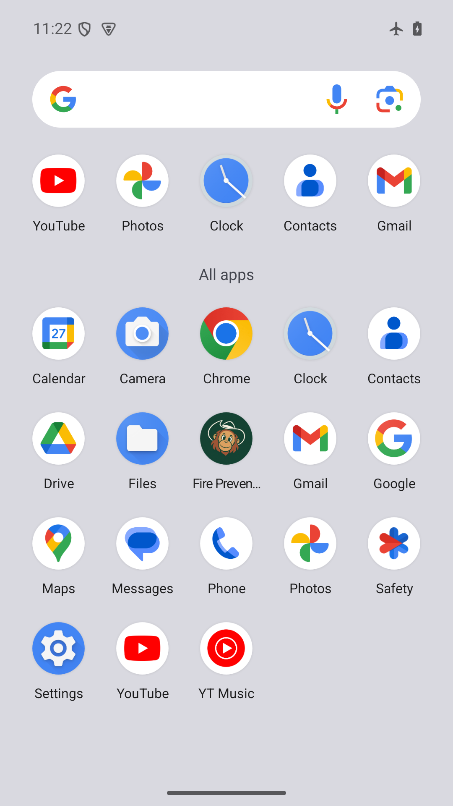
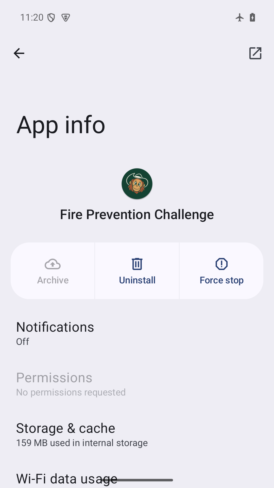

# Ikon aplikasi — v3 disetujui, 27 Oktober 2026

Pemilik proyek menyetujui ikon maskot minimalis v3 dan meminta penerapan ke aplikasi. [PNG sumber](../../../design/branding/fire-prevention-app-icon-v3.png) tetap utuh; [prompt dan persetujuan](../../../design/branding/fire-prevention-app-icon-v3.prompt.md), [indeks 16 ekspor](../../../design/branding/app-icon-manifest.json), [hasil verifikasi](app-icon-results.json).

## Perubahan

- Android: lima ukuran launcher legacy 48–192 px dan lima foreground adaptive 108–432 px. XML adaptive untuk API 26 ke atas memakai latar hijau yang dicocokkan ke tepi PNG sumber; manifest memakai ikon yang sama untuk launcher biasa dan lingkaran.
- Web: favicon 64 px, ikon pemasangan 192/512 px, varian maskable 192/512 px, serta Apple touch icon 180 px. Judul, nama pemasangan, deskripsi, dan warna metadata bawaan Flutter diganti sesuai proyek. Query versi ditambahkan ke URL favicon.
- README menampilkan ikon yang sama. Logo mitra dan maskot dalam permainan tetap memakai aset sebelumnya. Tidak ada perubahan Dart, alur, skor, audio, atau layout layar game.
- Reproduksi: `python tool/generate_app_icons.py` dari root repo, memerlukan Pillow. Turunan hanya melalui resize proporsional dan padding; tanpa generasi ulang, recoloring, pemotongan maskot, atau dependency Flutter tambahan. Menjalankan ulang menghasilkan hash identik untuk seluruh ekspor dan tidak mengubah PNG sumber.

Ruang aman mengikuti [panduan adaptive Android](https://developer.android.com/develop/ui/compose/system/icon_design_adaptive) dan [panduan maskable web](https://web.dev/articles/maskable-icon). Artwork sumber ditempatkan pada bagian tengah 72 dp dari layer Android 108 dp; varian web maskable mendapat margin tambahan. Segmentasi warna menunjukkan seluruh stroke terang/hangat berada di dalam area aman, lalu bentuk kepala/topi diperiksa pada hasil launcher Android yang benar-benar terpasang. Segmentasi ini merupakan pemeriksaan pendukung, bukan pengganti hasil native.

## Verifikasi aktual

| Pemeriksaan | Hasil |
| --- | --- |
| `flutter analyze --no-pub` | Bersih |
| Pembuka dan shell web | 17 tes terkait lulus; tidak menjalankan ulang seluruh suite E2E untuk perubahan aset ini |
| Web release | Berhasil; server baru pada port 8080 melayani manifest serta enam PNG web yang hash-nya cocok dengan sumber |
| Browser T3 | Judul, favicon 64 × 64, nama pemasangan, tema hijau, dan empat entri ikon manifest dibaca dari browser yang berjalan; pembuka dirender tanpa aset hilang |
| APK review | Release 1.0.3, versionCode 20261027, 75.805.059 byte; build berhasil |
| Isi APK | 53 aset runtime cocok; sepuluh PNG launcher/foreground cocok per piksel setelah optimasi nama resource Android; XML adaptive dan warna latar dibaca dari APK |
| Native API 35 | Pembaruan APK berhasil, ikon launcher/App info diperiksa, lalu ikon disentuh dan game terbuka sampai tombol Mulai Tantangan |
| Bentuk dan ukuran | Bukti native 1080 × 1920, density 420; lima density resource Android dan varian web diverifikasi. Tidak mengklaim foto/uji fisik TV 42 inci |

SHA-256 APK: `dffab3b3299c25d43b50b1054a03e8a641b4dffc0de5c5d2190ea9fa852dd52d`.

Paket lokal: `build/review-app-icon-2026-10-27/KIFC-Review-1.0.3.apk`. Tetap memakai sertifikat Android Debug untuk review, bukan signing produksi. Log analisis, tes, build, HTTP, resource APK, dan smoke native tersimpan pada direktori review yang sama. Pemeriksaan launcher dilakukan pada emulator khusus; perangkat Android USB yang terhubung tidak dipasang/dimodifikasi.

## Screenshot native

Keduanya screenshot emulator dari APK 1.0.3 yang sudah terpasang, bukan mockup atau render widget.

| Launcher | App info |
| --- | --- |
|  |  |

Perubahan ini telah diterapkan lokal. Status push/deployment dicatat terpisah dari hasil build dan instalasi emulator.
