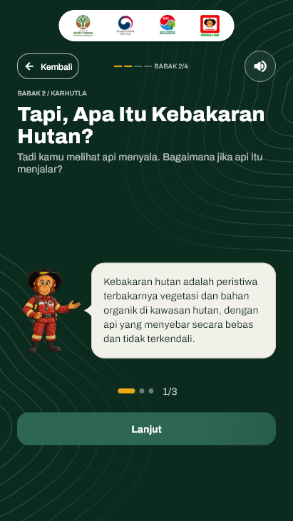
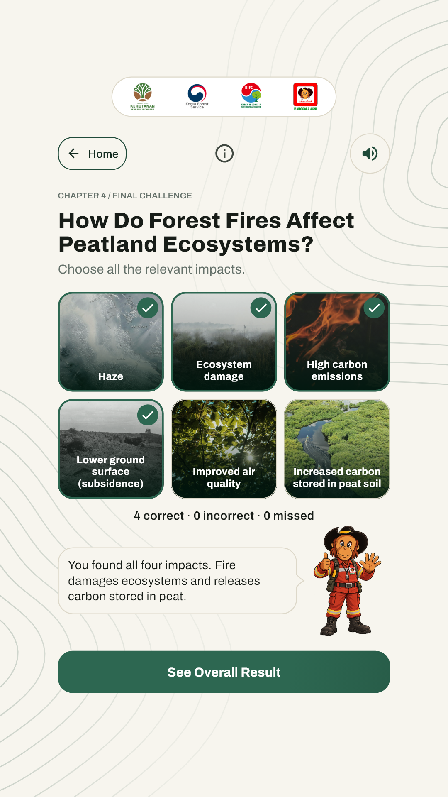
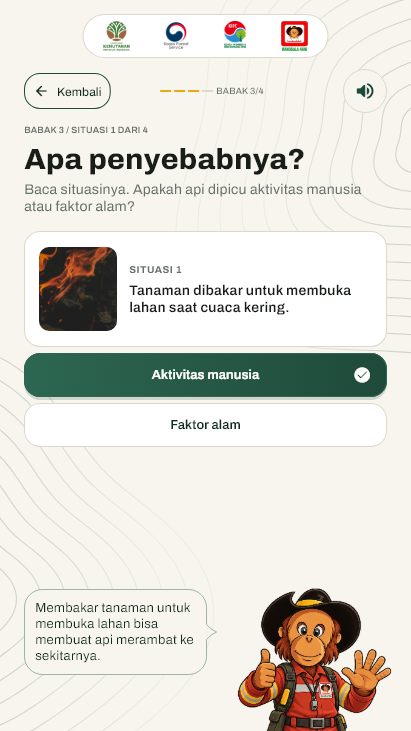

# Audit bubble lintas halaman — 27 Oktober 2026

Pemilik proyek meminta pemeriksaan masalah yang sama di halaman lain setelah bubble welcome disatukan. Audit menelusuri seluruh pemakaian ekor bubble khusus pada alur `ExhibitionGame` yang aktif, lalu mereproduksi masalah sebelum mengubah kode.

## Temuan dan penanganan

| Komponen / halaman | Kondisi sebelum audit | Perubahan |
| --- | --- | --- |
| Tiga kartu bacaan karhutla (`_MascotDialogue`) | Ekor berada di luar `MotionReveal`, tetap terlihat saat pesan memudar | Kotak, ekor, outline dan shadow memakai satu bentuk serta satu reveal |
| Ulasan tantangan dampak (`_FinalReviewDialogue`) | Ekor di luar reveal, baik saat maskot di kiri maupun kanan | Memakai bubble bersama dengan arah sesuai hasil; ukuran ekor 8×16 tetap |
| Feedback jawaban / petunjuk (`_MascotFeedback`) | Animasi ekor sudah ikut, tetapi bentuk dan border kotak masih terpisah | Sambungan menjadi satu outline, mempertahankan warna netral/benar/salah |
| Welcome / penutup (`_HostConversation`) | Sudah diperbaiki pada revisi sebelumnya | Memakai komponen bersama agar tidak menyimpang dari halaman lain |
| Panel penjelasan unsur, demo pengurangan, dan hasil skor | Tidak memiliki ekor terpisah; panel sudah berada di wrapper animasinya | Tidak dirombak |

Semua percakapan kini menggunakan `_SpeechBubble` dan `_SpeechBubbleShape`. Tidak ada lagi `_SpeechTail` terpisah pada kode game. Pemicu bahasa/pesan yang sama diteruskan ke bubble dan maskot; delay, durasi, reduced motion, font, lebar baca, ukuran jawaban, posisi/crop maskot, dan kontrol tetap mengikuti perilaku sebelumnya. Tidak ada perubahan naskah, aturan skor, audio, atau urutan layar.

## Verifikasi

- Empat kasus gagal sebelum fix: ekor kartu bacaan dan ulasan memiliki opacity 1 saat pesan 0, serta garis pemisah pada feedback kiri dan kanan. Keempatnya lulus sesudah fix.
- **172 tes terkait lulus**: 127 tes interaksi/layout/timer ditambah 45 tes tiga kartu bacaan. Empat tes audit dijalankan ulang setelah perapian format tes, tanpa dihitung dua kali dalam total. Analisis Flutter bersih.
- Cakupan meliputi welcome/penutup, feedback penyusunan unsur, petunjuk dan jawaban kuis gambut, penyebab kebakaran, kartu informasi gambut, ulasan dampak sempurna/campuran, retry, kelanjutan lewat tap, dialog dan deadline 15 detik.
- **462 screenshot widget unik** dihasilkan pada tiga bahasa dan lima ukuran portrait: 360×640, 411×731, 720×1280, 1080×1920, 2160×3840. Sampel bacaan tiap bahasa, kedua sisi feedback, ulasan, serta kartu gambut diperiksa visual; bukan klaim membaca seluruh 462 gambar satu per satu. Semua file dan metadata diindeks pada `build/review-speech-bubble-audit-2026-10-27/evidence-index.json`.
- Build web release berhasil; hash `main.dart.js` server lokal cocok dengan build baru. Tidak ada dependency baru atau aset sumber yang diubah.
- APK review **1.0.5 (20261029)** berhasil dibangun. Tiga ABI memuat komponen serta shape bubble bersama, dan 53 hash aset runtime cocok. File lokal: `build/review-speech-bubble-audit-2026-10-27/KIFC-Review-1.0.5.apk`, SHA-256 `3fb03003f97fb384beec891a51da7b1985e51dbf5100885af3a61e7cb13ee95b`. Paket tetap memakai signing review Android Debug; bukan rilis dengan kunci produksi.

[Hasil terstruktur](speech-bubble-audit-results.json). Log red/green, tes akhir, analisis, build dan lembar inspeksi tersimpan di direktori QA lokal yang sama. Bukti berupa render Flutter, bukan foto TV 42 inci; jangkauan fisik tidak diuji ulang.

## Screenshot representatif

| Kartu penjelasan | Ulasan akhir | Feedback benar |
| --- | --- | --- |
|  |  |  |

Tambahan: [feedback salah](speech-bubble-audit/wrong-feedback.png), [kartu gambut Korea](speech-bubble-audit/peat-cards-ko.png). Bahasa, dimensi sumber, dan checksum tercatat pada hasil terstruktur dan indeks QA.

Perbaikan masih lokal; belum push/deploy. Pemeriksaan runtime native dan TV fisik tidak diulang pada audit ini.
