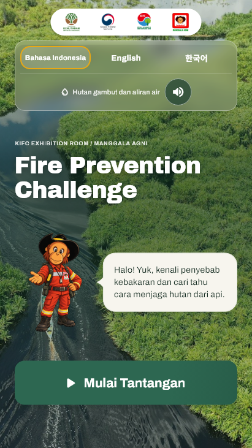
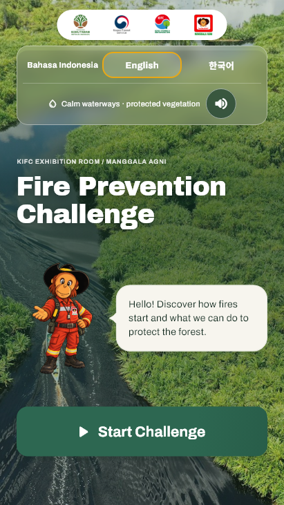
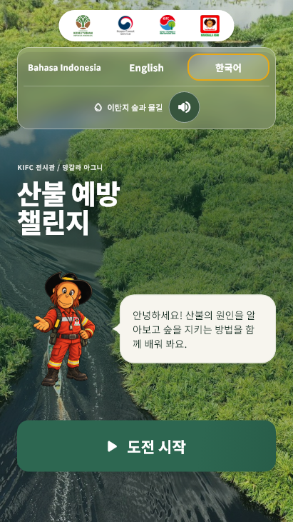

# KIFC-01 — bubble menyatu dan transisi bahasa, 27 Oktober 2026

Pemilik proyek melaporkan ekor bubble welcome tetap terlihat saat kotak dialog dan maskot dianimasikan. Permintaan berikutnya menegaskan ekor harus menyatu seperti bubble chat, tanpa garis pemisah di pangkalnya.

Commit implementasi: `5cd094f` pada `main` lokal.

## Temuan dan perubahan

1. Ekor sebelumnya merupakan `ClipPath` di luar `MotionReveal`. Kotak dialog memudar/bergeser sendiri, sedangkan ekor tetap terlihat. Kini bubble digambar sebagai satu `ShapeBorder`: rounded rectangle dan ekor kurva digabung menjadi satu path sehingga fill, outline, dan shadow menyambung. Satu `MotionReveal` membungkus keseluruhan bentuk.
2. Pemicu animasi sebelumnya hanya memakai teks sumber. Indonesia dan Korea memakai teks sumber yang sama sebelum lokalisasi sehingga perpindahan langsung ID–KO tidak memutar ulang animasi. Pemicu kini memuat bahasa aktif dan pesan, juga diteruskan ke maskot. Memilih bahasa yang sudah aktif tidak mengulang animasi.
3. Ruang ekor tetap dihitung dalam padding bentuk sehingga lebar teks, font, posisi maskot, jarak, dan timing masuk sebelumnya dipertahankan. Komponen host yang sama di penutup memakai ekor di kanan; arah tersebut juga diperiksa.

Tidak ada perubahan skor, alur babak, naskah, audio, atau aset maskot. Bentuk ini khusus percakapan host pembuka/penutup; bubble feedback lain tidak ikut dirombak.

## Verifikasi

- Tiga reproduksi gagal sebelum perbaikan: ekor memiliki opacity 1 saat pesan 0; perpindahan langsung ID–KO tidak memulai entrance; piksel sambungan berwarna border (kanal merah 222) saat seharusnya cream (247).
- **30 tes terkait lulus**, mencakup transisi ID/EN/KO, opacity/slide, pemilihan ulang bahasa aktif, reduced motion, piksel sambungan tanpa sekat, arah penutup, komponen motion, pembuka, dan shell web.
- **48 render widget**: 45 frame welcome untuk tiga bahasa × lima ukuran × tiga fase 40/155/500 ms, ditambah tiga penutup. Ukuran portrait 360×640, 411×731, 720×1280, 1080×1920 dan 2160×3840. Ini simulasi viewport, bukan foto atau pengujian TV fisik.
- Analisis Flutter bersih; build web release berhasil. SHA-256 `main.dart.js` yang dilayani server lokal cocok dengan build baru, sehingga browser tidak memakai bundle sebelumnya.
- APK review **1.0.4 (20261028)** berhasil dibangun dengan compile baru; tiga ABI memuat kelas bubble baru dan 53 hash aset runtime cocok. SHA-256 APK `cef7eff623b50dcc26f4760e11eaddf65360d356cd90cb7e4c36f655f6b43a3f`. File lokal: `build/review-welcome-tail-2026-10-27/KIFC-Review-1.0.4.apk`. Sertifikat tetap Android Debug untuk review. Tidak memasang/menguji ulang runtime native pada revisi ini; bukti visual berasal dari widget dan browser.
- [Video pergantian bahasa](welcome-bubble/language-switch.mp4) direkam dari browser T3 yang berjalan, memakai kontrol bahasa asli ID → KO → EN → ID. Rekaman asli 1600×1000 piksel, viewport CSS 1280×800; video yang disimpan hanya di-crop ke frame portrait 540×960, tanpa perubahan kecepatan atau menggambar ulang UI. Rekaman asli dan frame inspeksi tetap berada di direktori QA lokal.

[Hasil terstruktur](welcome-bubble-results.json). Semua frame, log red/green, log analisis/build dan indeks bukti tersimpan pada `build/review-welcome-tail-2026-10-27/`. Render representatif welcome, fase transisi, simulasi TV, dan penutup sudah diperiksa secara visual. Tidak menjalankan ulang seluruh suite E2E atau pengujian TV fisik untuk revisi ini.

## Tampilan akhir

Screenshot berikut merupakan render widget Flutter pada 411×731 saat animasi sudah selesai.

| Indonesia | Inggris | Korea |
| --- | --- | --- |
|  |  |  |

Web lokal: `http://127.0.0.1:8080/?revision=welcome-bubble-20261027`. Perbaikan ini belum di-push/deploy; situs GitHub Pages masih memakai versi sebelumnya selama pemeriksaan lokal.
